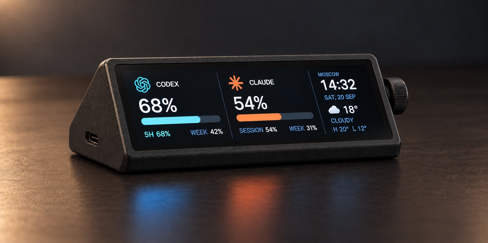
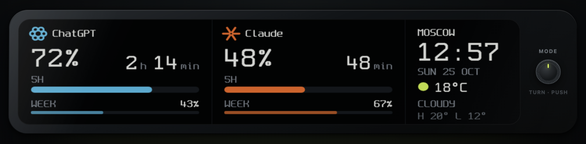
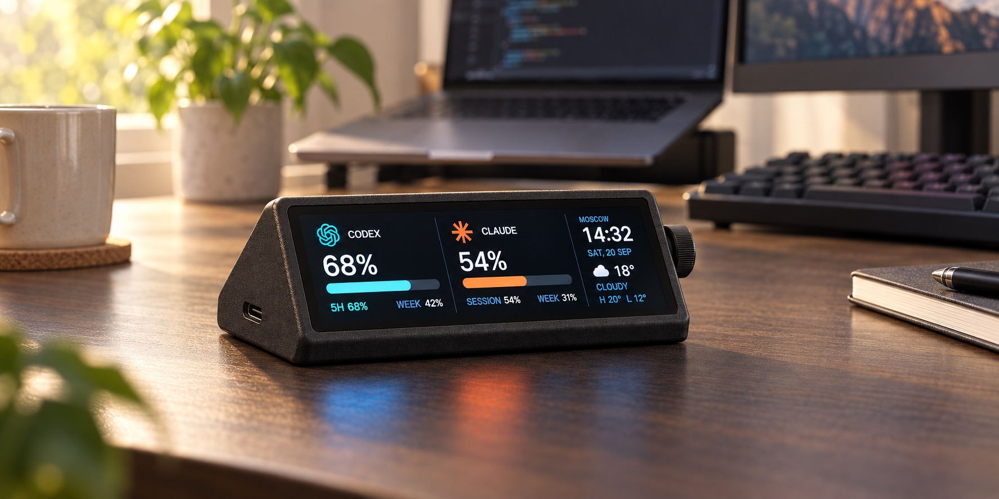
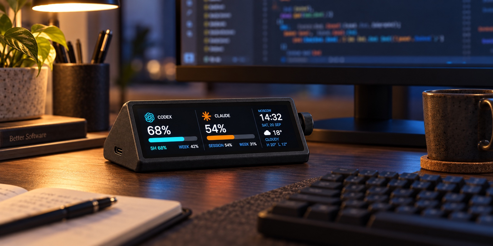
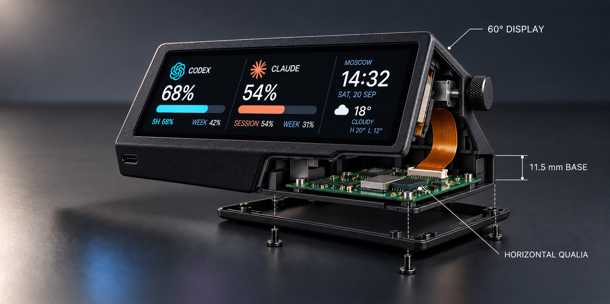
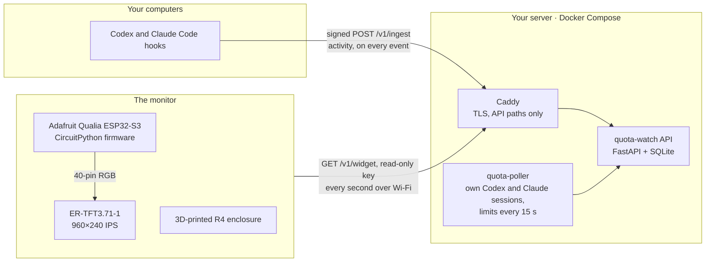

<h1 align="center">Agents Usage &amp; Limits Monitor</h1>

<p align="center">
  <b>A tiny desk display that shows how much of your Codex and Claude Code limits is left,<br>
  and whether your coding agents are working, waiting for you, or done.</b>
</p>

<p align="center">
  
</p>

<p align="center">
  
  <br><sub>The real panel layout, drawn by the <a href="simulator/">browser simulator</a> with the same fonts and primitives as the firmware.</sub>
</p>

You hand a task to an agent, switch to something else, and come back to find
it has been waiting for your approval for ten minutes. Or you start a big
refactor and hit the 5-hour limit halfway through. This monitor sits next to
your keyboard and answers both questions at a glance, for every computer you
work on:

- **How much is left.** The remaining share of the 5-hour window, the time
  until it resets and the weekly remainder, for Codex (ChatGPT plan) and
  Claude Code (Pro/Max plan), side by side.
- **What the agents are doing.** `WORKING`, `WAITING` for your input or
  approval, `IDLE` or `ERROR`, aggregated across all your machines.
- **When they finish.** The whole screen flashes "CODEX COMPLETED" or
  "CLAUDE COMPLETED" when a provider goes from busy to idle.
- **Calm by design.** A 3.71" 960×240 IPS bar at 60°, pixel fonts readable from
  60 cm, no touch, no buttons. If the network drops, the last values stay on
  screen and the link dot turns from green to coral.

<table>
  <tr>
    <td width="50%"></td>
    <td width="50%"></td>
  </tr>
  <tr>
    <td width="50%"></td>
    <td width="50%"></td>
  </tr>
</table>

<sub>The photo-style images are concept renders of an earlier enclosure revision (R3) with a
rotary encoder, which the current build does not have. The bottom-right image is the
printable R4 enclosure from this repository. Photos of the built unit are coming.</sub>

## How it works



| Layer | Folder | What it is |
|---|---|---|
| Model | [`enclosure/`](enclosure/) | Parametric 3D-printable case: three parts, STL ready to slice |
| Hardware | [BOM below](#1-buy-the-parts) | Adafruit Qualia ESP32-S3 board + ER-TFT3.71-1 bar LCD, one USB-C cable |
| Backend | [`backend/`](backend/) | Self-hosted API, server-side limits poller, IDE hooks for your computers |
| Frontend | [`firmware/`](firmware/), [`simulator/`](simulator/) | The panel UI on the device, and the same UI in a browser |

**Privacy.** Your computers send only an anonymised session state (a hash of
the session ID, the state, the computer's name). No tokens, API keys, prompts,
answers, code or file paths leave them. Limits are read on your server by a
poller with its own Codex and Claude sessions, which you can revoke at any time.
Every computer signs its requests with its own key; the display has a
separate read-only key.

## Build your own

About an evening of work once the parts arrive: print, deploy, flash, assemble.

### 1. Buy the parts

| Qty | Part | Notes |
|---:|---|---|
| 1 | [ER-TFT3.71-1](https://www.buydisplay.com/bar-type-3-71-inch-240x960-ips-tft-lcd-display-spi-rgb-interface), 3.71" 240×960 IPS bar LCD, ST7701S, SPI + 18-bit RGB, 40-pin FPC | BuyDisplay. Take the version **without touch**. Not the HMI/UART model (ER-TFT3.71-1-5982) |
| 1 | [Adafruit Qualia ESP32-S3 for TTL RGB-666 displays](https://www.adafruit.com/product/5800) (PID 5800) | 16 MB flash, 8 MB PSRAM, Wi-Fi; the LCD plugs straight into it |
| 1 | USB-C data cable, up to 4.5 mm thick | Plug plus strain relief up to 28 mm long, or a right-angle plug |
| 1 | USB power adapter, 5 V, 2 A or more | Any phone charger will do |
| 4 | M2.5 × 4 self-tapping screws | Board to the bottom cover |
| 4 | M2 × 6 self-tapping screws | Bottom cover to the shell |
| 1 | 0.6 mm black EVA foam strip, ~3 mm wide | Gasket between bezel and glass |
| 1 | Thin VHB tape, a small piece | Holds the left end of the bezel |
| ~40 g | PETG filament, black | PLA is fine for a test fit |

You will also need a 3D printer (any 0.4 mm nozzle FDM printer with at least
110 × 60 mm of bed and 110 mm of height), a small Phillips screwdriver and a Linux server with Docker
(1 vCPU, 1 GB RAM and a domain name are enough).

### 2. Print the enclosure

Three parts, no supports except a little under the shell's left end cap. PETG,
0.2 mm layers, 4 perimeters, 25% gyroid.

| Part | File | Orientation |
|---|---|---|
| Bottom cover | [`asb-r4-bottom-cover-pcb-tray.stl`](enclosure/exports-r4/asb-r4-bottom-cover-pcb-tray.stl) | Flat, standoffs up. Print first and test-fit the board |
| Shell | [`asb-r4-low-wedge-shell.stl`](enclosure/exports-r4/asb-r4-low-wedge-shell.stl) | Standing on its right end |
| Screen bezel | [`asb-r4-screen-bezel.stl`](enclosure/exports-r4/asb-r4-screen-bezel.stl) | Front face down, pins up |

All dimensions are parameters in `enclosure/params-r4.scad`; the Python
builder regenerates the STLs and checks every part for collisions. Details:
[enclosure/README.md](enclosure/README.md).

### 3. Deploy the backend

```bash
git clone https://github.com/MalyshkoA/agents-usage-and-limits-monitor.git
cd agents-usage-and-limits-monitor/backend
cp .env.example .env && cp .env.poller.example .env.poller && chmod 600 .env .env.poller
openssl rand -hex 32   # once per computer, once for the poller, once for the display
# edit .env: QWB_DOMAIN, QWB_DEVICE_KEYS_JSON, QWB_WIDGET_KEYS
# edit .env.poller: QWB_POLLER_SECRET (the "server-poller" key)
docker compose up -d --build quota-watch caddy
docker compose run --rm -it quota-poller quota-watch-poller login   # sign in to Codex and Claude
docker compose up -d quota-poller
curl -H 'X-Widget-Key: <display key>' https://quota.example.com/v1/widget
```

Caddy gets a TLS certificate for `QWB_DOMAIN` on its own. Details and every
option: [backend/README.md](backend/README.md).

### 4. Connect your computers

On every machine where you run Codex or Claude Code, install the small client
and merge the hooks:

```bash
python3 -m venv ~/.local/share/quota-watch-bridge
~/.local/share/quota-watch-bridge/bin/pip install ./backend
mkdir -p ~/.config/quota-watch
cp backend/client.example.toml ~/.config/quota-watch/client.toml   # server_url, device_id, providers off
umask 077 && printf '%s\n' '<this computer key>' > ~/.config/quota-watch/device-secret
```

Then add the hooks from `backend/config/codex-hooks.json` to `~/.codex/hooks.json`
and from `backend/config/claude-settings.fragment.json` to `~/.claude/settings.json`.
See [Connect your computers](backend/README.md#connect-your-computers).

### 5. Flash the display

1. Install the latest stable [CircuitPython for the Qualia](https://circuitpython.org/board/adafruit_qualia_s3_rgb666/).
2. `circup install -r firmware/requirements.txt`
3. Copy `code.py`, `celebrate.py`, `fonts/` and `images/` to the `CIRCUITPY` drive.
4. Create `CIRCUITPY/settings.toml` from `firmware/settings.toml.example`: your
   Wi-Fi, `QWB_WIDGET_URL`, the read-only `QWB_WIDGET_KEY`, your UTC offset.

Connect the LCD only with USB unplugged, and check the FPC pinout against the
datasheet first. Details and troubleshooting: [firmware/README.md](firmware/README.md).

### 6. Assemble

Board onto the cover, LCD into the face pocket, gasket and bezel on top, tail
into the board, cable through the back, cover on. Step by step with drawings:
[enclosure/README.md](enclosure/README.md#assemble).

## Try the UI without hardware

```bash
python3 -m http.server 4173 -d simulator
```

Open <http://localhost:4173>: the 960×240 panel with demo values, a pixel grid
and a few concept scenes. See [simulator/README.md](simulator/README.md).

## Repository layout

```text
agents-usage-and-limits-monitor/
├── backend/      API, limits poller, IDE hooks, Docker Compose with Caddy
├── firmware/     CircuitPython runtime for the Qualia: code, fonts, icons, settings template
├── simulator/    The panel UI in a browser
├── enclosure/    R4 case: STL, parameters, builder, previews, drawings
└── docs/images/  Renders and screenshots
```

## Status and ideas

This is a working prototype: the backend, the firmware with live limits and the
R4 enclosure are done. R4 is designed against the real LCD module and the
official board files and passes the builder's collision checks; see
[what to check on your parts](enclosure/README.md#check-on-your-parts) before
the final print.

Ideas for later: a rotary encoder to switch scenes (as in the concept renders),
real weather, a Cyrillic pixel font, 3 to 4 providers on one screen (the layout
already supports it), OTA updates, and a custom narrow PCB that fits behind the
display instead of the Qualia.

## Licenses and credits

- Code (backend, firmware, simulator, enclosure builder): [MIT](LICENSE).
- Enclosure models and parameters (`enclosure/`): [CC BY 4.0](enclosure/LICENSE).
- [Spleen](https://github.com/fcambus/spleen) pixel font by Frederic Cambus, BSD-2-Clause
  ([license](firmware/fonts/LICENSE-spleen.txt)).
- The "COMPLETED" titles are pre-rendered with Big Noodle Titling; the font itself is not included.
- The provider icons are derived from the ChatGPT and Claude desktop app icons to identify the
  services. ChatGPT and Codex are trademarks of OpenAI, Claude is a trademark of Anthropic.
  This project is not affiliated with either company.
