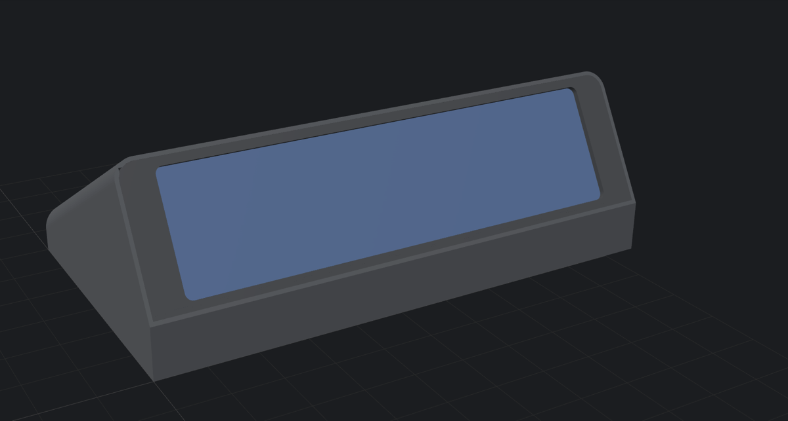
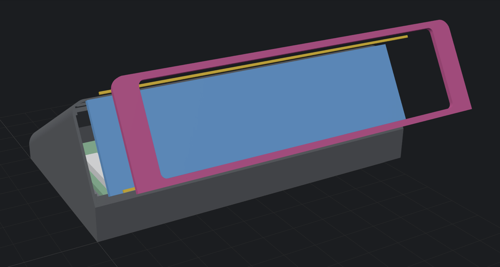
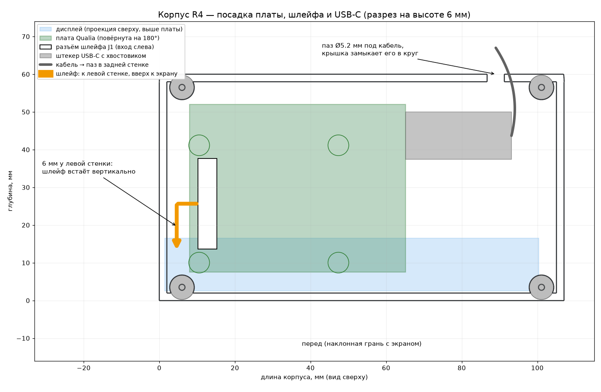
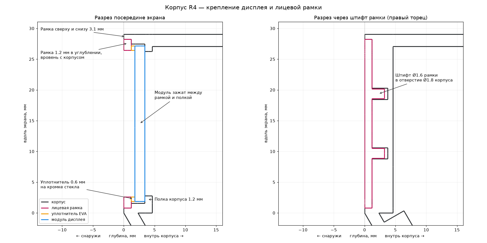

# Enclosure (revision R4)

A low wedge that holds the screen at **60° to the desk**, with the Qualia board
lying flat in the base. Three printed parts, eight screws, one cable out of the
back, no visible openings.

<p align="center">
  
  
</p>

- Overall `107.09 × 60 × 35.67 mm`.
- The ER-TFT3.71-1 module (`98.89 × 25.30 mm`) drops into a pocket in the face
  onto a `1.2 mm` ledge; a flush front bezel clamps it over a `0.6 mm` EVA
  gasket.
- Visible frame: `7.83 mm` at both ends, `3.1 mm` top and bottom. The active
  area is not centred on the module (per the datasheet its border is `6.35 mm`
  at the FPC end and `1.10 mm` at the other), so the pocket is offset and the
  window is centred in the body.
- The Qualia sits on four standoffs at its M2.5 holes, rotated 180° so its FPC
  connector faces the left wall, where the LCD tail turns upright.
- The USB-C plug stays inside; the cable leaves through a `Ø5.2 mm` hole in the
  rear wall. Vent slots are in the bottom cover.

You can also spin the model in 3D: GitHub renders the `.stl` files below, and
`exports-r4/asb-r4-preview.html` / `asb-r4-exploded.html` show the coloured
assembly (serve the folder with `python3 -m http.server`).

## Print

| File | Orientation on the bed | Supports |
|---|---|---|
| [`exports-r4/asb-r4-bottom-cover-pcb-tray.stl`](exports-r4/asb-r4-bottom-cover-pcb-tray.stl) | Flat, standoffs up | None. Print it first and test-fit the Qualia |
| [`exports-r4/asb-r4-low-wedge-shell.stl`](exports-r4/asb-r4-low-wedge-shell.stl) | Standing on its right end | Only under the left end cap |
| [`exports-r4/asb-r4-screen-bezel.stl`](exports-r4/asb-r4-screen-bezel.stl) | Front face down, pins up | None |

- PETG for the real thing (PLA is fine for a fit check). Print the shell and
  the bezel in the same black filament so they read as one frame.
- 0.4 mm nozzle, 0.2 mm layers, 4 perimeters, 25% gyroid infill.
- All three parts together are about 30 cm³ of plastic, under 40 g of PETG.

`asb-r4-assembly-preview.stl` and the `.glb` files are previews with dummy
board and LCD blocks; do not print them.

## Hardware for assembly

| Qty | Part |
|---:|---|
| 4 | M2.5 × 4 self-tapping screws (Qualia to the cover standoffs) |
| 4 | M2 × 6 self-tapping screws (cover to the shell) |
| 1 | 0.6 mm black EVA foam strip, about 3 mm wide (gasket on the glass border) |
| 1 | Small piece of thin VHB tape (left end of the bezel) |
| 1 | USB-C cable up to 4.5 mm thick; plug and strain relief up to 28 mm long, or a right-angle plug |

## Assemble



1. Screw the Qualia to the cover standoffs with 4 × M2.5 × 4 screws, FPC
   connector J1 towards the left. A 5 mm screw would bottom out in the cover.
2. Lay the LCD into the face pocket from the front, FPC end on the left, and
   pass its tail through the opening behind it.
3. Put the EVA strip on the glass border, outside the active area. Drop the
   bezel into the face recess with its two pins in the holes at the right end;
   a dab of VHB on the recess floor holds the left end, which has no pins.
4. Turn the shell over. With the cover held next to it, connect the tail to J1
   (USB unplugged!) and plug the USB-C cable into the board.
5. Lay the cable into the rear notch, close the cover (its tab closes the notch
   into a round hole around the cable) and fasten it with 4 × M2 × 6 screws.



The engineering drawings in `exports-r4/*.png` carry Russian labels; the
dimensions are in millimetres.

## Check on your parts

R4 is built from the datasheet and the official Adafruit board files; the
builder below verifies that nothing collides. Before the final print measure
your own parts:

1. **Module orientation.** The FPC end (wide 6.35 mm border) must be on the
   left. If the picture is upside down, change `display.rotation` in firmware.
2. **Where the tail leaves the LCD.** J1 sits at about `x = 12.7, y = 25.7 mm`
   in the enclosure. If your tail exits far from the LCD's left end, move the
   board with `qualia_left`.
3. **Cable and plug.** `cable_d` (5.2 mm) suits 3.5 to 4.5 mm cables; a plug
   longer than `plug_len` (28 mm including strain relief) needs a right-angle
   or shorter plug.
4. **Clearance under and over the board.** The board stands on 2 mm standoffs
   (the underside has only solder jumpers and pin tails) and has at least 1 mm
   to the shell above.

## Change and rebuild

All dimensions live in [`params-r4.scad`](params-r4.scad). `build_r4.py` reads
every `name = number;` line from it, builds the parts with manifold3d and
writes `exports-r4/`:

```bash
cd enclosure
python3 -m venv .venv && .venv/bin/pip install -r requirements.txt
.venv/bin/python build_r4.py
```

It reports whether the Qualia, the LCD module, the bezel or the USB-C plug
intersect any printed part, whether the frame covers lit pixels, and whether
the LCD tail reaches J1. With the parameters as shipped it reproduces the STL
files in this folder byte for byte.

Board geometry (outline, mounting holes, J1 and USB-C positions) comes from
Adafruit's official [Qualia ESP32-S3 PCB files](https://github.com/adafruit/Adafruit-Qualia-S3-RGB666-PCB);
LCD dimensions from the [ER-TFT3.71-1 datasheet](https://www.buydisplay.com/download/manual/ER-TFT3.71-1_Datasheet.pdf).

## License

The enclosure models and parameters are licensed under
[CC BY 4.0](LICENSE): print, remix and sell them, with attribution.
